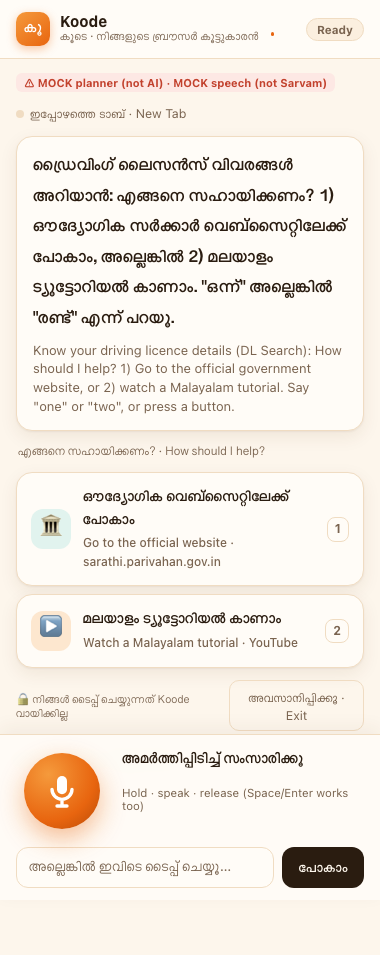
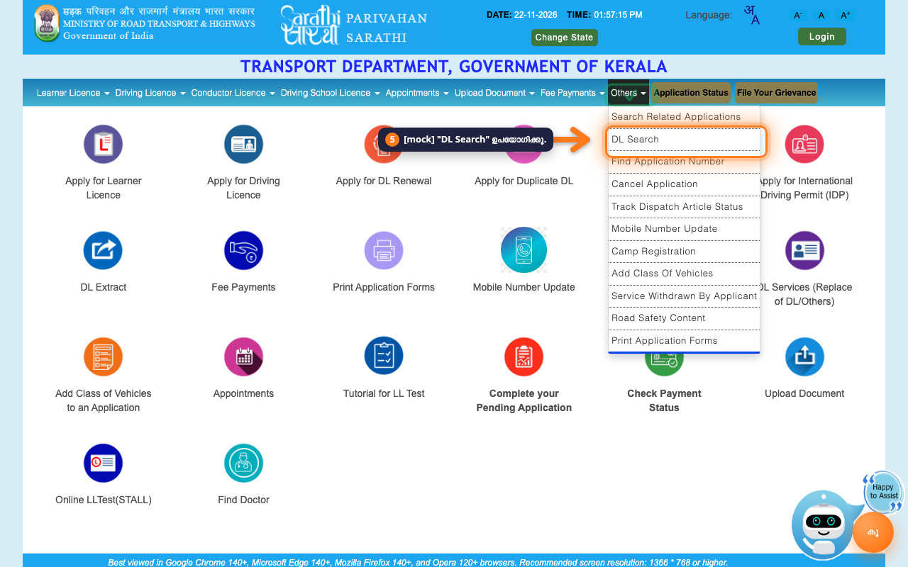
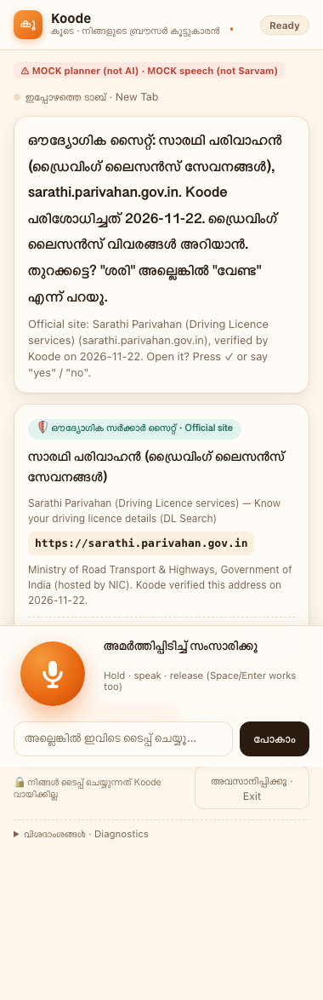
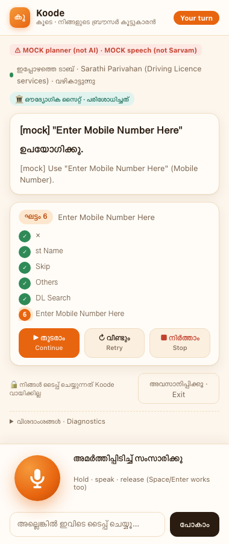
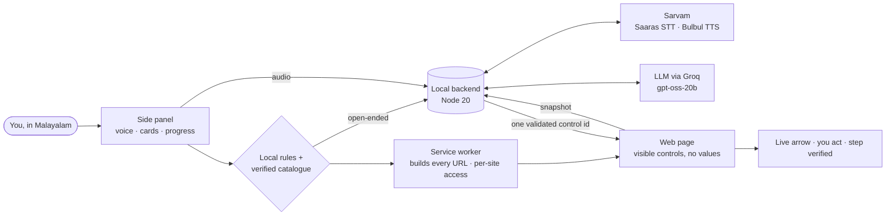

<p align="center">
  
</p>

<h1 align="center">Koode · കൂടെ</h1>

<p align="center"><b>The web speaks your language.</b></p>

<p align="center">
  A Malayalam-first AI companion that helps you navigate websites, discover services,<br>
  and get things done with confidence.
</p>

<p align="center">
  
  
  
  
</p>

<p align="center">
  <a href="#what-koode-does">Features</a> ·
  <a href="#how-koode-works">How it works</a> ·
  <a href="#getting-started">Getting started</a> ·
  <a href="#privacy-and-safety">Privacy</a> ·
  <a href="#roadmap">Roadmap</a>
</p>

<table align="center">
  <tr>
    <td align="center" width="34%"></td>
    <td align="center" width="66%"></td>
  </tr>
  <tr>
    <td align="center"><sub>Ask in Malayalam; choose the official site or a tutorial</sub></td>
    <td align="center"><sub>A live arrow on the real Sarathi Parivahan portal, step 5 of the route</sub></td>
  </tr>
</table>
<p align="center"><sub>Genuine captures from Koode's automated test runs. They used the labelled test planner, so instructions show <code>[mock]</code>; the Sarathi page is the live public site, logged out.</sub></p>

---

## Why Koode

Millions of people in Kerala know exactly what they need online: renew a licence, check an application, learn a
skill, fill a form. They get lost in English menus, crowded portals and look-alike websites. Usually the answer is
"ask someone to do it for you", which costs time, independence and sometimes privacy.

**Koode (കൂടെ, "with you") sits beside you instead.** You say what you want in Malayalam. Koode works out where
to go, points at the exact button on the real page, explains it in Malayalam, waits while *you* act, and checks
that it worked before moving on. You stay in control: Koode never clicks, types, logs in, pays or submits for you.

## What Koode does

| | |
|---|---|
| **Malayalam voice, both ways** | Hold the mic and speak naturally; Koode shows what it heard for you to confirm or correct, then replies aloud in Malayalam. Typing works too. |
| **Understands goals, not commands** | Plain requests such as *"I want to learn coconut-tree climbing"* become a plan: open a site, search for videos, offer a verified service, or guide you on the current page. |
| **Learning on YouTube** | Opens Malayalam-first YouTube results directly, tries an English query that keeps Malayalam content when results are thin, and points you to a relevant video. |
| **Verified government services** | Recognises the service you mean, offers the official website or a Malayalam tutorial, confirms the exact address before opening it, and guides you step by step. It guides you through **Sarathi Parivahan** (driving licence services) and opens verified Parivahan **vehicle** pages (vehicle details, Vahan services) with a clear hand-off. |
| **Live, grounded arrows** | Koode reads the controls that are actually visible, picks one real element (never screen coordinates), keeps the arrow attached as the page scrolls and changes, and points at a popup's close button first. |
| **Every step verified** | A step completes only when the page really changes after *your* action. A wrong click is noticed and gently corrected. |
| **Privacy first** | Typed values are never read; personal numbers are removed from your request before it reaches the AI planner; sensitive steps stay yours. |

## Talk to Koode

| You say | Meaning | Koode |
|---|---|---|
| `സോളാർ പാനൽ ഇൻസ്റ്റലേഷൻ വീഡിയോകൾ` | "Solar panel installation videos" | Opens Malayalam YouTube results and points at a relevant video. |
| `എനിക്ക് തെങ്ങ് കയറാൻ പഠിക്കണം` | "I want to learn to climb a coconut tree" | Understands the learning goal and searches for it. |
| `എനിക്ക് ഡ്രൈവിംഗ് ലൈസൻസ് വിവരങ്ങൾ അറിയണം` | "I want my driving licence details" | Offers **1** the official website or **2** a Malayalam tutorial. |
| `ഒന്ന്` | "One" | Shows the verified site (operator, exact address, verification date) and opens it only after you confirm. Then it guides you: state **Kerala** → **Others** → **DL Search**. |
| `ഈ ഫോം പൂരിപ്പിക്കാൻ സഹായിക്കൂ` | "Help me fill this form" | Guides you field by field; you type, Koode checks each step. |
| `വാട്സ്ആപ്പ് തുറക്കൂ` | "Open WhatsApp" | Opens WhatsApp Web, waits while you scan the QR code, and never reads your chats. |
| `നിർത്താം` | "Let's stop" | Ends the session and says goodbye. |

<p align="center">
  
  &nbsp;&nbsp;
  
</p>
<p align="center"><sub>Left: Koode confirms the official address before opening it. Right: progress, with Continue, Retry and Stop.</sub></p>

## How Koode works

1. **Listen.** Your voice is transcribed (Sarvam Saaras), shown back to you, and acted on only after you confirm.
2. **Protect.** Phone, Aadhaar, licence and other personal numbers in the request are replaced with placeholders in
   your browser, before any planner, URL or saved task sees them.
3. **Understand.** Fast local rules handle the common cases. Open-ended requests go to an intent model that may
   only suggest a plain search query or a *verified* service ID, never a web address.
4. **Go there safely.** Koode itself builds the URL: a YouTube search, or an official address from its verified
   catalogue. Official sites need your confirmation, and Chrome asks for access to that one site only.
5. **Guide.** On the page, Koode snapshots the visible controls (labels and states, no values). The planner picks
   one, Koode re-checks it against the live page and points at it, waits for you, and verifies the result.



### Technology

| Layer | Built with |
|---|---|
| Browser | Chrome extension (Manifest V3): side panel, content scripts (in-page UI in a closed shadow DOM), service worker; plain JavaScript, no build step |
| Backend | Node.js 20 with **zero runtime dependencies**: request sanitiser, validators, `/api/plan`, `/api/intent`, `/api/stt`, `/api/tts` |
| Language AI | Groq (`openai/gpt-oss-20b`) for intent and step planning; adapters for OpenAI, Anthropic and Gemini |
| Speech | Sarvam **Saaras v4** (speech-to-text) and **Bulbul v3** (Malayalam text-to-speech) |
| Testing | `node:test` unit suites; real-Chrome end-to-end runs (Playwright core) with trusted mouse and keyboard input |

## Getting started

> **Koode runs with a local backend.** The Chrome extension talks only to `localhost:8787`, which holds your API
> keys and calls the AI services. There is no hosted Koode service yet, so start the backend before using the
> extension.

**You need** Node.js 20+, Google Chrome 116+, and for real AI a [Groq](https://console.groq.com) API key and a
[Sarvam AI](https://www.sarvam.ai) API key.

```bash
git clone https://github.com/AravindRKrishnan7/Koode.git
cd Koode

# macOS: store keys in the Keychain. Each key is pasted at a hidden prompt and never written to a file,
# shell history or the repository.
security add-generic-password -a "$USER" -s koode-groq   -w
security add-generic-password -a "$USER" -s koode-sarvam -w

scripts/start-judging.sh        # real Groq + Sarvam on http://localhost:8787
```

Then load the extension:

1. Open `chrome://extensions` and turn on **Developer mode**.
2. Choose **Load unpacked** and select the `extension/` folder. Pin **Koode — കൂടെ**.
3. Click the Koode icon on any tab (even New Tab) to open the side panel, hold the mic and speak.

<details>
<summary><b>Other systems, or trying Koode without API keys</b></summary>

Start the backend by hand without putting keys on the command line:

```bash
cd backend
read -rs GROQ_API_KEY && export GROQ_API_KEY        # paste, then Enter (hidden)
read -rs SARVAM_API_KEY && export SARVAM_API_KEY
KOODE_PROVIDER=groq KOODE_REQUIRE_LLM=1 npm start    # listens on 127.0.0.1 only
```

With no keys, `npm start` runs a **clearly labelled mock planner** (scripted, not AI) so you can explore the
interface; the panel shows a red *MOCK* badge. `scripts/start-rehearsal.sh` runs the mock planner with real Sarvam
voice. Practice pages are served at `http://localhost:8787/demo/`.
</details>

## Privacy and safety

- **Your input stays yours.** Koode never reads what you type into fields; snapshots carry only "filled" and "valid"
  flags. Passwords, OTPs, captchas and licence or application numbers are marked sensitive, and you type them yourself.
- **Personal numbers are stripped early.** Aadhaar, phone, licence, PAN, vehicle and card numbers, emails and OTPs in
  your request are replaced in the browser before any AI planner, URL or saved task sees them, and the backend checks
  again. (Voice audio itself goes to Sarvam for transcription; typing avoids that.)
- **The AI never chooses where you go.** Models can pick a control from Koode's own list, a sanitised search query,
  or a verified catalogue ID. Code builds every URL and re-validates every target on the live page.
- **Official means verified.** Government destinations come from a small catalogue. Each entry is checked against
  the live site (valid TLS, operator, a link from the parent official portal) and records its evidence and a
  re-check date. Services without a verified entry are explained, never guessed. If a task drifts to another
  domain, Koode pauses: *"ഇത് ഔദ്യോഗിക സൈറ്റ് അല്ല"* ("this is not the official site").
- **Sensitive steps are yours.** Koode pauses with *"check your details"* before submit, payment or OTP steps,
  and stops reading the page after the OTP request.
- **Keys stay local.** API keys live only in the backend process, which listens on `127.0.0.1` and refuses calls from web pages.
  Requests about self-harm get a helpline answer (Tele-MANAS 14416, emergency 112), never a search.

## Limitations

- **Local backend required:** Koode is not yet packaged for the Chrome Web Store, and there is no hosted backend.
- **Few verified services so far:** step-by-step guidance on Sarathi Parivahan (Kerala route); Parivahan vehicle pages
  are opened after confirmation and handed over, without guidance. Other services are explained but not opened.
- **Chrome only.** The first visit to an official site needs a click to grant Chrome access (a voice "yes" can't
  open Chrome's permission prompt).
- **Rate limits and real sites:** free-tier AI limits can cause short "retrying" pauses, and live sites change
  their layouts. Koode re-reads the page every step, but some flows may need a retry.
- Logged-in WhatsApp Web has been tested only on a stand-in page.

## Roadmap

- More verified services, each added only with documented evidence: vehicle services (Vahan), Kerala e-District,
  and other high-demand portals.
- Choosing your state on national portals instead of assuming Kerala.
- A packaged extension and an optional hosted backend for easier installation.
- Broader understanding of Malayalam dialects and Manglish (Malayalam typed in Latin letters).
- A finer action policy that recognises login, payment and final-submit steps on any site.

## Contributing

Ideas, bug reports and Malayalam phrasing examples are very welcome. Please open an issue first. **Koode does not
have an open-source license yet**, so please discuss before sending substantial code.

When contributing:

- run `cd tests && npm install && npm run unit`, plus the mock end-to-end suites in [docs/HACKATHON.md](docs/HACKATHON.md#tests);
  they never use paid APIs;
- add verified services in `extension/src/shared/catalogue.js` with their verification evidence, never a URL from
  memory;
- keep the safety rules intact: no reading input values, no model-chosen URLs, the user performs every action.

## Documentation

| | |
|---|---|
| [docs/ARCHITECTURE.md](docs/ARCHITECTURE.md) | The guidance loop and module layout |
| [docs/CONTRACTS.md](docs/CONTRACTS.md) | API contracts: `/api/plan`, `/api/intent`, speech, catalogue and permissions |
| [docs/COMPANION.md](docs/COMPANION.md) | Side panel, routing, verified services, privacy rules |
| [docs/DEMO.md](docs/DEMO.md) | Demo-laptop setup and the real-microphone test |
| [docs/HACKATHON.md](docs/HACKATHON.md) | Run modes, demo script, test suites and verification status |

<p align="center"><sub>Built with care for Malayalam speakers · കൂടെ — always with you.</sub></p>
